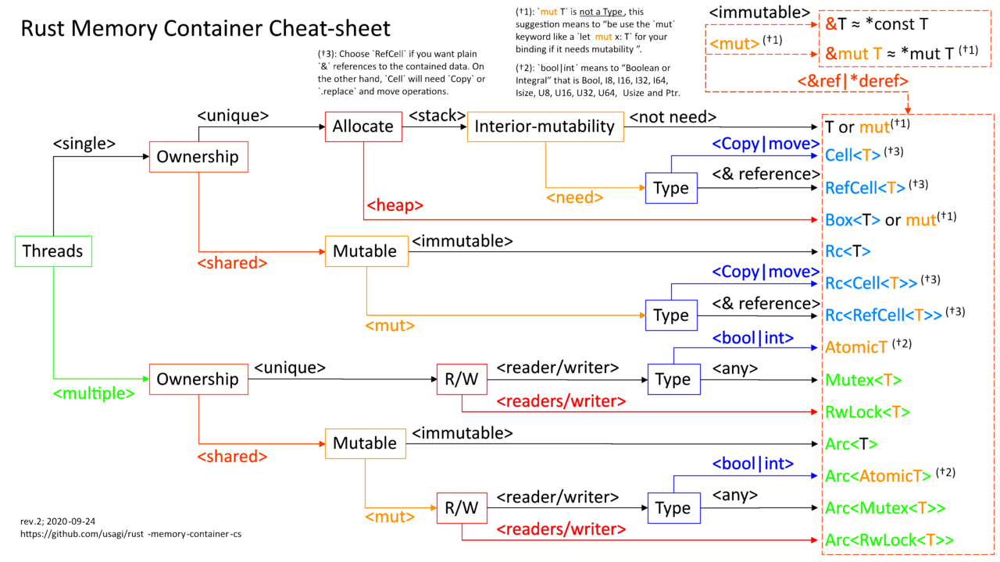

# Ownership and smart pointers

### Single owner

- Direct ownership:
  - Stack: `T`
  - Heap: `Box<T>`
- Temporary borrow:
  - Read-only: `&T`
  - Mutable: `&mut T`
- Clone-on-write:
  - `Cow<'a, T>`

### Multiple owners (single thread)

- Read-only: `Rc<T>`
- Needs mutation:
  - Clone-on-write: `Rc<T>` + `Rc::make_mut()` (requires `T: Clone`)
  - Runtime checks: `Rc<Cell<T>>` (small `Copy` types)
  - Runtime checks: `Rc<RefCell<T>>`
- Break cycles: `Weak<T>`

### Multiple owners (multiple threads)

- Read-only: `Arc<T>`
- Needs mutation:
  - Simple counters/flags: `Arc<AtomicT>`
  - Clone-on-write: `Arc<T>` + `Arc::make_mut()` (requires `T: Clone`)
  - Reads >> writes: `Arc<RwLock<T>>`
  - Otherwise: `Arc<Mutex<T>>`
- Break cycles: `Weak<T>`

## Cheat sheet

